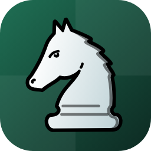
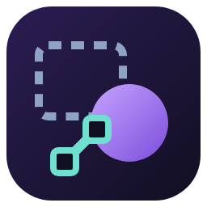
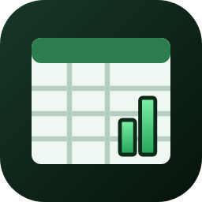
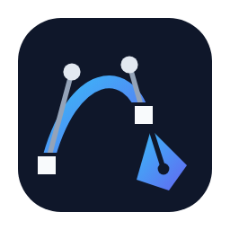

> [Version française](APPS-fr.md)

# Kazo OS Store apps

Every app you can install from the Store of [Kazo OS](https://github.com/Kazo-ca/Os). **Try it** opens the app in Kazo OS in your browser, with nothing to install on your computer. This page is rewritten by the **Publish catalog** workflow each time the catalog changes.

11 apps. Last publication: 2026-11-25.

| | App | Description | Version | Category | Links |
| --- | --- | --- | --- | --- | --- |
|  | **Chess** `ca.kazo.chess` | Chess for two on one screen or against Stockfish \(5 levels\), with a clock, undo and saved games \(.pgn\). Opens: .pgn | 1.1.2 | Entertainment | [Try it](https://os.kazo.ca/?autolaunch=ca.kazo.chess) · [Source](https://github.com/Kazo-ca/Os-App-Chess) · GPL-3.0 |
|  | **IRC** `ca.kazo.irc` | Chat on real IRC networks: WebSocket without any server, Libera.Chat and OFTC through the Kazo server. | 1.0.3 | Communication | [Try it](https://os.kazo.ca/?autolaunch=ca.kazo.irc) · [Source](https://github.com/Kazo-ca/Os-App-IRC) · MIT |
|  | **Kazo AI** `ca.kazo.ai` | Chat with AI models using your own keys \(OpenRouter, OpenAI, Ollama\) or a local GPU model, with race mode and AutoTune. | 0.1.4 | Productivity | [Try it](https://os.kazo.ca/?autolaunch=ca.kazo.ai) · [Source](https://github.com/Kazo-ca/Os-App-AI) · MIT |
|  | **Kazo Deck** `ca.kazo.deck` | A presentation editor for Kazo OS, built on DeckCraft. Opens: .rtf, .pptx, .ppsx, .potx, .deckcraft, .md, .txt | 0.1.2 | Productivity | [Try it](https://os.kazo.ca/?autolaunch=ca.kazo.deck) · [Source](https://github.com/Kazo-ca/Os-App-Deck) · MIT |
|  | **Kazo Fig** `ca.kazo.fig` | Interface design and prototyping for .figcraft files, based on FigCraft by the ArtCraft team. Opens: .json, .fig, .figcraft, .jam, .penpot, .sketch, .gif, .jpg, .jpeg, .png, .svg, .tif, .tiff, .webp | 0.1.2 | Graphics | [Try it](https://os.kazo.ca/?autolaunch=ca.kazo.fig) · [Source](https://github.com/Kazo-ca/Os-App-Fig) · MIT |
|  | **Kazo Pdf** `ca.kazo.pdf` | A PDF reader and editor for Kazo OS, built on PdfCraft. Opens: .pdf | 0.1.2 | Productivity | [Try it](https://os.kazo.ca/?autolaunch=ca.kazo.pdf) · [Source](https://github.com/Kazo-ca/Os-App-PDF) · MIT |
|  | **Kazo Photo** `ca.kazo.photo` | A layered image editor for Kazo OS, built on PhotoCraft. Opens: .dcm, .dicom, .dc3, .ase, .af, .afdesign, .afphoto, .afpub, .kra, .krz, .pcraft, .abr, .act, .grd, .psb, .asl, .aco, .psdt, .bmp, .fits, .fit, .fts, .gif, .heic, .heif, .hif, .jpg, .jpeg, .ora, .png, .qoi, .svg, .svgz, .tif, .tiff, .dds, .psd, .ico, .hdr, .webp, .dng, .cr2, .cr3, .cin, .xcfgz, .dpx, .exr, .raf, .iff, .lbm, .ilbm, .nef, .nrw, .orf, .pdn, .rw2, .pef, .pam, .pbm, .pfm, .pgm, .ppm, .arw, .tga, .xcf | 0.1.2 | Graphics | [Try it](https://os.kazo.ca/?autolaunch=ca.kazo.photo) · [Source](https://github.com/Kazo-ca/Os-App-Photo) · MIT |
|  | **Kazo Spreadsheets** `ca.kazo.spreadsheets` | A spreadsheet for .xlsx, .ods and .csv workbooks, based on GridCraft by the ArtCraft team. Opens: .json, .xls, .xlsb, .xlsm, .ods, .xlsx, .slk, .csv, .txt, .tsv | 0.1.2 | Productivity | [Try it](https://os.kazo.ca/?autolaunch=ca.kazo.spreadsheets) · [Source](https://github.com/Kazo-ca/Os-App-Spreadsheets) · MIT |
|  | **Kazo Vector** `ca.kazo.vector` | A vector drawing app for Kazo OS, built on VectorCraft. Opens: .ai, .pdf, .eps, .epsf, .ps, .afdesign, .ait, .vectorcraft, .vctemplate, .emf, .svg, .svgz, .dxf, .wmf | 0.1.2 | Graphics | [Try it](https://os.kazo.ca/?autolaunch=ca.kazo.vector) · [Source](https://github.com/Kazo-ca/Os-App-Vector) · MIT |
|  | **Kazo Word** `ca.kazo.word` | A word processor for .docx and .odt documents, based on WordCraft by the ArtCraft team. Opens: .doc, .dot, .rtf, .docm, .dotm, .odt, .fodt, .ott, .docx, .dotx, .tex, .html, .htm, .md, .txt | 0.1.5 | Productivity | [Try it](https://os.kazo.ca/?autolaunch=ca.kazo.word) · [Source](https://github.com/Kazo-ca/Os-App-Word) · MIT |
|  | **Webamp** `ca.kazo.webamp` | Winamp 2's player: your music, .m3u/.pls playlists, .wsz skins, equalizer and Milkdrop. Opens: .m3u8, .wsz, .aac, .flac, .m4a, .mp3, .ogg, .oga, .opus, .wav, .weba, .m3u, .pls | 1.1.3 | Music and video | [Try it](https://os.kazo.ca/?autolaunch=ca.kazo.webamp) · [Source](https://github.com/Kazo-ca/Os-App-Webamp) · MIT |

To propose an app, read the [catalog README](https://github.com/Kazo-ca/Os-AppMarketPlace#readme).
